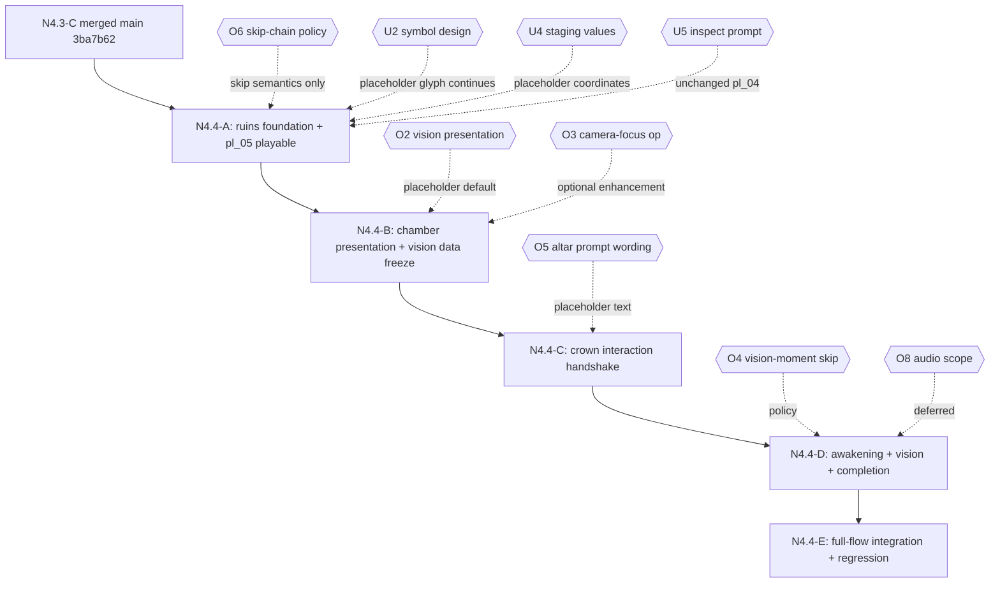

# Crownfall — N4.4 Implementation Roadmap (PROPOSED)

**Status (updated 2026-11-18):** the slice plan below remains the N4.4 contract; **slice N4.4-A is IMPLEMENTED** on `feature/n44a-ruins-foundation` per its documented defaults (see [`N44A_IMPLEMENTATION_REPORT.md`](N44A_IMPLEMENTATION_REPORT.md) — including the two implementation refinements recorded there: the pl_04-skip default is a documented branch rather than a runtime bool constant, and `set_active_beat` now owns prompt hygiene on beat changes after a demonstrated stale-prompt defect). **Decision O6 is APPROVED by the owner (2026-11-18, Option A — skip chain continues): the §6 merge gate below is RESOLVED and the shipped skip behavior is now an approved decision, not a default.** Slices N4.4-A (PR #23) and N4.4-B (PR #25) are merged on `main`; slice N4.4-C is implemented on `feature/n44c-crown-interaction`. Slice N4.4-D (vision sequence, R15 post-vision dialogue, O4 Option A skip, N4.4 boundary) is implemented on `feature/n44d-vision-sequence`. Slice N4.4-E remains PROPOSED/unimplemented.
**Inputs:** [N44_PREPRODUCTION_REPORT.md](N44_PREPRODUCTION_REPORT.md) (R-matrix, scene specs) · [N44_ARCHITECTURE_DESIGN.md](N44_ARCHITECTURE_DESIGN.md) (ADR, contracts) · [N44_TEST_STRATEGY.md](N44_TEST_STRATEGY.md) · [N44_OWNER_DECISIONS.md](N44_OWNER_DECISIONS.md) (gating).

---

## 1. Slice structure — evaluation of the proposed A–E split

The mission's suggested structure (A foundation, B exploration/chamber, C altar/handoff, D awakening/vision, E integration) **is adopted with two refinements**, because the audit shows:

1. The ruins "foundation" (bounds/zones/child component) and its first playable proof (pl_05 exploration → altar) are one coherent reviewable unit — splitting them would create a slice whose tests cannot assert player-visible behavior. → **N4.4-A = foundation + pl_05 playable.**
2. The awakening handshake and the vision sequence share one lock/generation lifecycle; separating them would force a temporary, throwaway completion path. → **N4.4-D = awakening + vision + post-vision dialogue + completion as one slice.**

Final slices: **A — Ruins foundation & pl_05 playable · B — Chamber presentation & altar staging (see note) · C — pl_05→pl_06 handshake & crown interaction · D — Awakening, vision, completion · E — Full-flow integration & regression.**

Refinement note: with A delivering pl_05 playable, the original B ("exploration and hidden chamber") collapses into A's zone work; B is re-scoped to the chamber-reveal presentation polish + zone-content review gate (keeps five independently reviewable slices without a hollow slice). If the owner prefers four slices, B merges cleanly into A.

## 2. Slice specifications

### N4.4-A — Ruins foundation & pl_05 playable
1. **Objective:** the exploration segment continues past pl_04 into a bounded, placeholder ruin world; reaching the altar records pl_05 exactly once and activates pl_06 (dormant — no interaction yet beyond movement).
2. **Scope:** bounds/camera-constant extension; `PrologueRuinsEnvironment` component (zones + triggers, fail-closed build); stage pl_05 branch; shell chain extension (pl_04→pl_05→pl_06 activation, no segment end at pl_04 per O6); skip plumbing per O6; boundary/status text groundwork.
3. **Production files expected:** `scripts/narrative/PrologueShell.gd`, `PrologueExplorationStage.gd`, `PrologueExplorer.gd` (constants only), new `PrologueRuinsEnvironment.gd`, `PrologueBeats.gd` (pl_05 text/cue data).
4. **Test files expected:** new component suite; N43A/N43C constant+path updates (explicitly listed, no assertion weakening); full-flow groundwork.
5. **Dependencies:** decision O6 (skip-chain policy) for the skip semantics; O7/O1 only as labels (placeholders proceed without approval).
6. **Acceptance criteria:** full pl_01→pl_05→(dormant pl_06) flow headless; pl_05 exactly-once (normal + skip per O6); cancel/exit/teardown record nothing; N4.3 regression green.
7. **Negative-path tests:** failed component build → fallback boundary; duplicate pl_05 requests ignored; cancel during pl_05 zones.
8. **Visual verification:** ruins zones render as labelled placeholders; camera containment at the new east bound; no empty-space exposure.
9. **Documentation updates:** roadmap N4.4 status, runtime design implemented-beats note, breakdown slice row (A implemented).
10. **Out of scope:** altar interaction prompt, awakening/vision, any pl_07 content.

### N4.4-B — Chamber presentation & content review gate
1. **Objective:** the chamber reveal reads correctly as an environmental discovery (no HUD), and the vision/awakening placeholder content is approved as a reviewable list before D wires it.
2. **Scope:** chamber reveal presentation (placeholder overlay per O2/O3 baseline), zone art polish (placeholders), vision caption data freeze (R12 set, R13 fence review), interaction prompt placeholder text proposal (O5).
3. **Production files expected:** `PrologueRuinsEnvironment.gd` (presentation), `PrologueBeats.gd` (vision cue data).
4. **Test files expected:** component suite presentation cases; data-level vision-fence assertions.
5. **Dependencies:** O2 (vision presentation baseline = fullscreen placeholders; O3 optional enhancement), O5 (prompt wording placeholder continues until approved).
6. **Acceptance criteria:** reveal is cancel-safe and one-shot per run; vision data validated + fenced; windowed check passes.
7. **Negative-path tests:** reveal after teardown does nothing; vision data rejects unknown/extra fragments (fail-closed validation).
8. **Visual verification:** reveal framing screenshot; vision placeholder storyboard screenshots.
9. **Documentation updates:** preproduction report status notes; owner-decision register statuses.
10. **Out of scope:** awakening completion semantics (D), audio (O8).

### N4.4-C — pl_05→pl_06 handshake & crown interaction
1. **Objective:** approaching and interacting with the crown works behind the full D5 gate and hands off into the awakening lifecycle.
2. **Scope:** altar/crown eligibility + prompt (placeholder wording), interact handshake, actor lock at contact, completion armed-not-emitted, vision `play()` rejection handling (no stuck lock), retry semantics.
3. **Production files expected:** `PrologueRuinsEnvironment.gd`, `PrologueExplorationStage.gd` (pl_06 branch), `PrologueBeats.gd` (interaction data).
4. **Test files expected:** component + integration suites (interaction matrix).
5. **Dependencies:** N4.4-A/B; O5 (prompt placeholder).
6. **Acceptance criteria:** interact at range triggers awakening exactly once per segment; out-of-range/ineligible presses are no-ops; prompt visibility matrix passes.
7. **Negative-path tests:** interact during dialogue/vision/teardown; interact out of range; rejected vision play leaves no lock and no armed completion.
8. **Visual verification:** prompt-in-range screenshot; prompt absent during pl_05 (R6 keeps pl_05 prompt-free).
9. **Documentation updates:** runtime design contract bullets (interaction gate).
10. **Out of scope:** vision playback (D), completion emission (D).

### N4.4-D — Awakening, vision, completion
1. **Objective:** the full pl_06 emotional sequence works: contact → awakening → fragmented vision (abrupt end) → post-vision candidate dialogue → pl_06 recorded exactly once → N4.4 boundary.
2. **Scope:** authored `pl_06_vision` runner sequence (existing ops only); shell handshake to the runner; two-lock arrangement during the vision; skip semantics per O4; boundary state + status text (O6); pl_07 explicitly NOT started.
3. **Production files expected:** `PrologueBeats.gd` (vision + post-vision lines), `PrologueExplorationStage.gd`, `PrologueShell.gd`.
4. **Test files expected:** full-flow shell A–E suites (vision/cancel/skip matrices), runner-level vision cases.
5. **Dependencies:** N4.4-A/B/C; O4 (vision-moment skip granularity); R15 candidate-text confirmation at review.
6. **Acceptance criteria:** exactly-once completion (normal + skip paths distinct); cancel/unload during any phase records nothing; vision ends abruptly; fencing assertions green.
7. **Negative-path tests:** the F7–F13 set of the test strategy (stale callbacks, duplicate completion, lock leakage, invalid transitions).
8. **Visual verification:** awakening + vision + boundary screenshots; actor stillness under held input during the vision (H14 pattern).
9. **Documentation updates:** runtime design guards bullet; breakdown slice row (D implemented).
10. **Out of scope:** pl_07+; camera-focus op (unless O3 approved — then optional enhancement, not required); audio (O8).

### N4.4-E — Full-flow integration & regression
1. **Objective:** prove the whole N4.4 experience as one reliable flow (the N4.3-C discipline).
2. **Scope:** the full-flow suite shells A–E; 10× stability; full regression; verifier; CI registration updates; windowed visual pass; docs synchronization.
3. **Production files expected:** none expected; fixes only if the suite demonstrates a real defect (N4.3-C policy).
4. **Test files expected:** `tests/test_n44_full_flow.gd` + run_all.sh/CI registration.
5. **Dependencies:** A–D complete.
6. **Acceptance criteria:** 10/10 stability runs; ALL SUITES PASSED; verifier PASS; real files byte-exact; visual pass inspected.
7. **Negative-path tests:** as listed in the test strategy §3 shells B–E.
8. **Visual verification:** the complete screenshot set (test strategy §4).
9. **Documentation updates:** CHANGELOG entry; roadmap/breakdown status; implementation report (N4.4 report in the N43C format).
10. **Out of scope:** any new content; any art/audio approval claims.

## 3. Dependency graph

**Solid arrows = implementation order (hard dependencies). Dotted = decision inputs that do NOT block implementation**, because every affected value ships as a labelled placeholder with the approved fallback. The only gate that can block a merge (not the work) is O6: until the owner rules on the pl_04-skip policy, slice A must ship the N4.3-epoch behavior (pl_04 skip ends the segment) or the O6-recommended behavior behind an explicit, reviewable constant — the roadmap recommends implementing the O6 recommendation (skip → pl_05) and marking the PR for owner review, since the current N4.3 text is explicitly epoch-scoped.

## 4. Sequencing rationale

- A before everything: every later slice builds on the zones/component.
- B before C/D: freezing the vision fragment data early prevents re-work in the handshake (C) and completion (D) slices, and gives the owner a concrete, reviewable vision storyboard before the emotional-peak code lands.
- D before E: integration tests the real sequence, not scaffolding.
- E mirrors N4.3-C so the stabilization discipline is unchanged.
