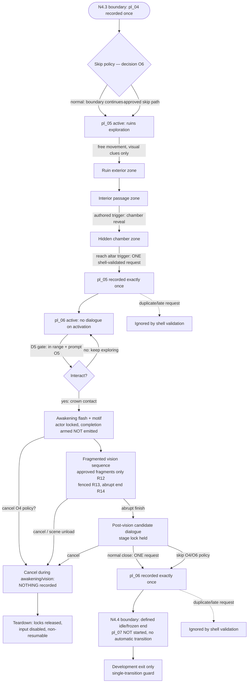

# Crownfall — N4.4 Pre-Production Report (Forgotten Ruins & Crown's Call)

**Status:** PROPOSED design package (planning only — nothing here is implemented, and nothing here converts an OPEN story detail into canon).
**Story authority:** [PROLOGUE_STORY_DESIGN.md](PROLOGUE_STORY_DESIGN.md) (Beats 05–06, §2, §6, §9, §10).
**Runtime contract:** [NARRATIVE_RUNTIME_TECHNICAL_DESIGN.md](NARRATIVE_RUNTIME_TECHNICAL_DESIGN.md) (N0 beat table, §E guards, decision record).
**Production inventory:** [PROLOGUE_PRODUCTION_BREAKDOWN.md](PROLOGUE_PRODUCTION_BREAKDOWN.md) (pl_05/pl_06 rows, §3, §5 N4.4 row).
**Companion documents:** [N44_ARCHITECTURE_DESIGN.md](N44_ARCHITECTURE_DESIGN.md) · [N44_TEST_STRATEGY.md](N44_TEST_STRATEGY.md) · [N44_IMPLEMENTATION_ROADMAP.md](N44_IMPLEMENTATION_ROADMAP.md) · [N44_OWNER_DECISIONS.md](N44_OWNER_DECISIONS.md).

---

## 1. Phase 0 — post-merge reconnaissance (2026-11-18)

### 1.1 Repository baseline

- **Current `main` HEAD:** `3ba7b62` — **PR #21 (N4.3-C) is merged** (`merge_commit_sha 3ba7b626…`), and GitHub CI on the PR head ran `completed / success`. The full N4.3 stack is verified present in `main` history: `a4e8560` (UI-layer fix), `d206bf7` (N4.3-C suite), `d1de385` (docs sync).
- Working tree clean at branch point; `docs/n44-preproduction` branched from `3ba7b62`.
- Verified `git diff origin/main..origin/feature/n43c-full-flow-integration-regression` is empty (the merged main content equals the reviewed N4.3-C tip).
- Baseline suites re-confirmed on this content during N4.3-C delivery: verifier 251 checks, N43C 176, N43B 193, N43A 106, N42 113, N41 87 — all exit 0.

### 1.2 Existing N4.4 documentation and work

- **No N4.4 implementation exists.** `grep` across `docs/`, `scripts/`, `scenes/`, `tests/` finds pl_05/pl_06 only as *planned* references: Story Design Beats 05–06, the runtime N0 beat table rows `pl_05_forgotten_ruins` / `pl_06_crowns_call`, the breakdown §2 rows + §5 N4.4 slice row, roadmap prose, and N4.3 docs' explicit "pl_05 is NOT fabricated" boundary rules. No `pl_05`/`pl_06` ids exist in any script or scene.
- The N4.3 documents deliberately fence N4.4 out: `N4_3_PLANNING.md` §4 ("pl_04 skip … does not start pl_05"), §8 exclusions, and the N4.3 boundary status text ("Later beats (N4.4+) are not implemented yet") are epoch-correct and become **update points** for N4.4 (see §5.3 here and the roadmap doc).

### 1.3 Existing reusable systems (verified on current main)

| System | Location | State |
|---|---|---|
| PrologueShell (chain, exploration segment, skip/cancel/exit, sole `NarrativeState` writer) | `scripts/narrative/PrologueShell.gd` | implemented; chain ends after pl_04 at the N4.3 boundary |
| PrologueExplorationStage (road environment, per-beat branches, stage-owned lock, D5-gated interact polling, one-shot completion requests) | `scripts/narrative/PrologueExplorationStage.gd` | implemented for pl_03/pl_04 |
| PrologueExplorer (1-D movement, clamped bounds, camera limits == authored band, no offset) | `scripts/narrative/PrologueExplorer.gd` | implemented |
| PrologueMarkInspectables (atomic fail-closed prop set, range query, per-run idempotent inspection, shared prompt) | `scripts/narrative/PrologueMarkInspectables.gd` | implemented for pl_04 |
| PrologueBeats (authored content; BEAT_IDS = pl_01/pl_02; exploration text/cues for pl_03/pl_04) | `scripts/narrative/PrologueBeats.gd` | implemented |
| SequenceRunner (typed allowlisted ops: dialogue, wait, lock/unlock_control, play_cue, change_scene, finish; generation-guarded cleanup) | `scripts/narrative/SequenceRunner.gd` | implemented; **no fade / camera-focus op** (D9 PROPOSED) |
| DialoguePanel (CanvasLayer 100), PlayerControlLock, NarrativeState | `scripts/narrative/*` | implemented |
| Shell UI on camera-immune `UICanvasLayer` (N4.3-C fix) | `scenes/narrative/PrologueShell.tscn` | implemented |
| Camera-immune UI pattern; N4.3-C regression assertion (screen-rect containment) | `tests/test_n43c_full_flow.gd` | implemented |

### 1.4 Asset inventory (located, not assumed)

- `assets/` contains **51 files**: gameplay props/buildings/NPC sheets/enemy, `assets/characters/player/player_monarch_sheet.png` (8 frames: 0–3 idle, 4–7 walk — the Prologue explorer's only character asset), environment backgrounds (`bg_forest_mid.png`, `bg_mountains_far.png`, …), and **SFX only** (`assets/audio/`: bow/build/coin/hit/night/sunset `.wav`).
- **Missing for N4.4 (confirmed absent):** any ruin exterior/interior art, hidden-chamber art, altar prop, crown prop, vision fragment visuals, ruin ambience/drone audio, resonance-motif audio, awakening/vision SFX. The Prologue so far ships **zero image/audio narrative assets** — all presentation is labelled placeholder `ColorRect`/`Label` geometry built in code (established, verified pattern).
- Consequence: N4.4 implementation must be placeholder-first (labelled, non-canon), exactly like N4.2/N4.3; art/audio remain owner approvals (see decision register).

### 1.5 Missing information and documentation contradictions

| # | Finding | Severity | Disposition |
|---|---|---|---|
| 1 | Breakdown §2 pl_06 test says "skip policy respected" while the runtime beat table marks pl_06 Skip **"Not allowed for the vision moment (PROPOSED)"** — the current `skip_current_exploration_beat()` is per-beat and would skip the whole beat including the vision | P2 (design gap) | Decision **O4** (vision-moment skip granularity) in the owner register; both readings documented |
| 2 | N4.3's "pl_04 skip ends the segment and does NOT start pl_05" (planning §4) is epoch-scoped; the per-beat skip chain precedent (pl_03 skip → pl_04) implies pl_04 skip → pl_05 once N4.4 exists | P2 (design gap) | Decision **O6** (skip-chain extension policy); N4.4 must not silently rewrite the N4.3 contract |
| 3 | Breakdown header baseline line still reads `main @ 539f8564` (stale vs the current header above it) | P3 | Historical note; the authoritative status line (updated 2026-11-18) supersedes it; not edited in this docs-only pass beyond what Phase 9 allows |
| 4 | Runtime design decision-record table has duplicated D8/D9 rows (pre-existing) | P3 | Pre-existing glitch, unrelated to N4.4; left untouched |
| 5 | The vision needs fades/short cuts ("uses runner waits/fades **when available**" — breakdown pl_06 camera row) but the runner has **no fade op** and D9 (camera-focus/pause-world) is PROPOSED | P2 (technical gap) | Architecture §3.3: placeholder-first vision presentation needs no new op; D9 activation becomes decision **O3** |
| 6 | Story Design §10 "Name of the ruins" OPEN; environment identity for the ruin zones is unapproved | P2 | Decision **O1** |
| 7 | No approved altar interaction verb/prompt (U5 covers the inspect prompt; the altar needs its own wording) | P2 | Decision **O5** |

### 1.6 Scope risks

- **Largest complexity in the Prologue:** the breakdown rates pl_05 and pl_06 **L** (highest) and advises "first in design review" — this package is that design review.
- The N4.3 boundary contract is user-visible (status text) and regression-tested (N43C suite asserts "N4.4+ … not implemented"); N4.4-A must update both deliberately, not silently.
- Vision content sits against the strictest lore fence in the project (five protected mysteries); every placeholder must be visibly labelled and non-canon.

---

## 2. Phase 1 — narrative requirement audit

### 2.1 pl_05 — The Forgotten Ruins (player-action decomposition)

Every item cites its source; nothing below is invented.

| Player action | Initiator | Player sees | Player can do | Feedback | Narrative-state change | End of interaction | Cancel/exit behavior | Source |
|---|---|---|---|---|---|---|---|---|
| Enter the ruins | pl_04 recorded exactly once (handoff from the N4.3 segment) | The ruin exterior ahead of the road (labelled placeholder zones) | Move (existing explorer) | Continuity from the road (no loading break) | pl_05 becomes the active beat | — (continuing beat) | Shell cancel/exit tears the segment down, records nothing (N4.3 contract) | runtime beat table row pl_05 (entry "pl_04 finished"); Story Beat 05 "the repeated mark leads Monarch to a larger ancient ruin" |
| Explore and follow visual clues | Free movement | Ruin exterior → interior zones; worn architecture (placeholder art) | Walk within bounds; observe | Environmental storytelling only — no NPC, no quest marker, no HUD | None until zone goals | — | Same as above | Story Beat 05 bullets 1–2 + "Do not add an NPC…"; breakdown pl_05 test "no NPC explains the history; route is environmental" |
| Discover the hidden chamber | Reaching the chamber route (authored trigger area) | Chamber reveal framing | Move | Reveal framing ("player-follow + reveal framing at the chamber", breakdown) | Zone state recorded per-run (not persisted) | — | Reveal is presentation-only; cancel-safe | Story Beat 05 bullet 3; breakdown pl_05 camera row |
| Find the crown on the altar | Reaching the altar at the chamber center | Crown prop on altar (placeholder, visual continuity object) | Approach | The recurring symbol is visible on/with the crown area (consistent placeholder glyph) | pl_05 completion request fires when the altar is reached | pl_05 recorded exactly once by the shell → pl_06 activates | Completion is shell-validated (active beat); duplicates ignored | Story Beat 05 bullet 4; runtime row pl_05 exit "Reach altar"; breakdown pl_05 test "altar interaction starts pl_06"; N4.3 ownership contract |

**pl_05 ends when the altar is reached** — the crown interaction itself belongs to pl_06 (the runtime table's exit condition for pl_05 is "Reach altar"; pl_06's content is "Touch crown → awakening + fragmented vision"). This split keeps exactly-once ownership identical to pl_03's handoff-area pattern.

### 2.2 pl_06 — The Crown's Call (player-action decomposition)

| Player action | Initiator | Player sees | Player can do | Feedback | Narrative-state change | End of interaction | Cancel/exit behavior | Source |
|---|---|---|---|---|---|---|---|---|
| Approach the altar/crown | pl_05 recorded; pl_06 active | Chamber + altar; prompt when in interaction range (wording OPEN — decision O5) | Move; interact (E) behind the D5 gate | Prompt identifies the altar only when eligible | None yet | — | D5 gate closes on cancel/exit (N4.3 contract) | Story Beat 06 bullet 1; breakdown pl_06 "crown + altar interaction"; N4.3-B gate pattern |
| Touch the crown (interact) | Player interact press | Awakening flash + short sound/visual motif recalling the childhood resonance (placeholders) | — | Actor locked during the awakening + vision (stage-owned lock; movement blocked) | pl_06 completion is armed but **not** emitted until the sequence lifecycle finishes | Awakening → vision starts | Cancel during awakening/vision records nothing (N4.3 ordering contract applies) | Story Beat 06 bullet 2–3; breakdown pl_06 animation/audio rows |
| Experience the fragmented vision | Automatic after contact | Vision fragments: ancient kingdom, ruler's silhouette, the recurring symbol, fading light, interrupted destruction — **must not identify** ruler/dynasty/kingdom/power source (placeholders, labelled) | Nothing (control locked; advance input not consumed by the vision — presentation-only) | Fades/short cuts; abrupt end | Vision is presentation-only; no narrative record of fragment content | Vision ends abruptly (authored sequence `finish`) | Cancel mid-vision → no completion; unload → teardown, nothing recorded | Story Beat 06 bullets 4–5; breakdown pl_06 test "vision excludes protected mysteries; ends abruptly"; runtime row pl_06 exit |
| Post-vision line | After the vision ends | DialoguePanel: "What... was that? / I've never seen those places before." (candidate text, precedent: Beats 01/03/04 candidates were implemented verbatim on owner acceptance) | Advance dialogue | Panel + stage lock | pl_06 completion request fires only after a normal dialogue close | pl_06 recorded exactly once → **N4.4 boundary** (defined idle/frozen end; pl_07 NOT started) | Cancel/skip during the line: skip records once (pl_04-pl_04 precedent) and ends the segment; cancel records nothing | Story Beat 06 candidate dialogue; N4.3-B record-after-dialogue ordering; N4.3 boundary contract |

### 2.3 Narrative requirement matrix

Statuses: APPROVED (owner-approved source), DERIVED (mechanically follows from an approved decision or implemented contract), PROPOSED (this package's proposal, needs owner), OPEN (owner decision pending), OUT OF SCOPE.

| # | Requirement | Source | Status | Confidence | Open decision |
|---|---|---|---|---|---|
| R1 | pl_05 entry = pl_04 finished | Runtime beat table row pl_05 | APPROVED | High | — |
| R2 | pl_05 player control: interactive exploration | Story §6 table; runtime row | APPROVED | High | — |
| R3 | Route: ruin exterior → interior → hidden chamber | Story Beat 05; breakdown pl_05 environment | APPROVED (spatial staging PROPOSED) | High | O1 (ruin identity), O7 (zone layout placeholders) |
| R4 | Environmental storytelling only; no NPC explains history | Story Beat 05 note; breakdown test | APPROVED | High | — |
| R5 | Hidden chamber contains the crown on an altar at its center | Story Beat 05 bullet 4; §2 "crown is found on an altar in a hidden chamber" | APPROVED | High | O7 (altar/crown staging placeholders) |
| R6 | pl_05 exit = reach the altar; completes exactly once via shell validation | Runtime row pl_05 exit; N4.3 ownership contract | DERIVED | High | — |
| R7 | Reveal framing at the chamber | Breakdown pl_05 camera row | APPROVED (direction); mechanism PROPOSED | High | O3 (camera-focus op) |
| R8 | Ruin ambience/low drone | Breakdown pl_05 audio | APPROVED (need); asset OPEN | High | O8 (audio scope) |
| R9 | pl_06 entry = pl_05 finished | Runtime row pl_06 | APPROVED | High | — |
| R10 | Approach + interact with the crown; contact awakens dormant inherited power | Story Beat 06 bullets 1–2; §2 | APPROVED | High | O5 (interaction prompt) |
| R11 | Awakening motif recalls the childhood resonance (short sound + visual) | Story Beat 06 bullet 3 | APPROVED (need); asset OPEN | High | O8 |
| R12 | Fragmented vision shows exactly: ancient kingdom, ruler's silhouette, recurring symbol, fading light, interrupted destruction | Story Beat 06 bullet 4; §2 bullet | APPROVED (content list); rendering PROPOSED | High | O2 (vision presentation) |
| R13 | Vision must NOT reveal: ruler identity, kingdom/dynasty name, power source, crown origin, Eclipse cause | Story Beat 06 fence; breakdown pl_06 visuals note; §9.7 | APPROVED | High | — |
| R14 | Vision ends abruptly | Story Beat 06 bullet 5; runtime row exit | APPROVED | High | — |
| R15 | Post-vision candidate dialogue (2 lines) | Story Beat 06 candidate | APPROVED-candidate (precedent: Beats 01/03/04 candidates implemented verbatim) | Medium-High | confirm at N4.4-C review |
| R16 | pl_06 completion recorded exactly once; skip policy respected | Breakdown pl_06 test; N4.3 ownership | APPROVED | High | O4 (vision-moment skip granularity) |
| R17 | pl_06 Skip "not allowed for the vision moment" | Runtime beat table (PROPOSED marker) | PROPOSED | Medium | O4 |
| R18 | After pl_06: defined N4.4 boundary; pl_07 NOT started; no automatic transition | N4.3 boundary contract (epoch-scoped, extended); runtime rows pl_06→pl_07 | DERIVED | High | O6 (boundary text update) |
| R19 | Crown = visual continuity object; no inventory | Breakdown §5 N4.4 row; runtime "Crown continuity" contract | APPROVED | High | — |
| R20 | Ruins have no canonical name | Story §10 "Name of the ruins — OPEN (may remain unnamed)" | APPROVED-OPEN | High | O1 |
| R21 | Symbol design consistency carried into the chamber/altar | Story §7 "One consistent royal-symbol design"; N4.3-B identical-glyph contract | APPROVED (consistency); design OPEN | High | U2 |
| R22 | Awakening grants nothing — the power already exists | Story pillar 3 | APPROVED | High | — |
| R23 | Player regains nothing new after the vision (no new abilities implemented in N4.4) | Story pillar 3; "awakens, does not grant"; scope fence | DERIVED | High | — |
| R24 | Vision fragment art/audio production | Breakdown pl_06 rows (N) | OUT OF SCOPE for implementation (placeholder-first) | High | O2, O8 |
| R25 | pl_05/pl_06 playable from the N4.3 boundary without replays | Chain continuation contract (non-resumable per-run state) | DERIVED | High | — |

### 2.4 Confidence notes

- All APPROVED rows trace to owner-authored documents; none depend on this package's prose.
- The only Medium-confidence item is R15 (candidate dialogue) — same acceptance pattern as earlier beats, but the owner has not yet blessed Beat 06's candidate text explicitly; flagged for the N4.4-C slice review rather than treated as a blocker (placeholders allow the slice to proceed).

---

## 3. Phase 4 — scene-level specifications

Spatial values below reuse the verified N4.3 world scale (road `[-800, +800]`, ground `y = 200`, camera band `[-240, +240]` vertical, zoom 1.5). Exact N4.4 coordinates are **staging placeholders** pending art approval (U4-equivalent for N4.4 = decision O7); they are stated only to prove feasibility at the existing scale.

### 3.1 pl_05 — The Forgotten Ruins scene specification

1. **Scene entry conditions:** shell-validated pl_04 completion (normal handoff-area completion **or** approved skip path per decision O6) while the exploration segment is live. No scene reload: the ruins are the continuation of the same exploration stage world (architecture §3.2, Option A).
2. **Initial player position:** wherever the player stands at the pl_04 boundary (east road area, `x ≈ 680+`); no forced teleport.
3. **Camera framing:** unchanged explorer camera contract (limits == movement band, no offset, N4.3-C containment assertions). The band simply extends east with the authored bounds (roadmap slice A owns the assertion updates).
4. **Environment layout:** three labelled placeholder zones continuing east — ruin exterior (approach façade), interior passage, hidden chamber. One-dimensional movement is preserved (every Prologue space is 1-D so far; the mission forbids inventing vertical/exploration frameworks).
5. **Exploration boundaries:** extended `move_min/max_x` with unchanged clamping guarantee (the actor can never escape the authored band — existing contract, verified by N43A containment tests).
6. **Discoverability:** visual clues only — the recurring glyph appears on ruin surfaces (same placeholder glyph as N4.3-B props, decision U2 governs the design); no quest marker, no HUD, no prompt during pure exploration (prompt only at the altar, R5/O5).
7. **Hidden chamber access conditions:** authored trigger area at the passage end; reaching it flips the zone presentation state (per-run, in-memory) and stages the reveal framing (PROPOSED: fullscreen placeholder overlay or camera-focus op per O3; both cancel-safe).
8. **Altar interaction requirements:** pl_05 completes exactly once when the actor reaches the altar trigger (handoff-area pattern; no interact input required for pl_05 completion — interaction belongs to pl_06). The stage emits its one validated `exploration_handoff_reached`-style request; the shell records pl_05 and activates pl_06.
9. **Interaction feedback:** none required for pl_05 completion itself (silent, like the pl_03 handoff); the chamber reveal is the only presentation event.
10. **Narrative sequence handoff:** pl_06 activation opens no dialogue (recognition-style presentation only).
11. **Cancellation and teardown:** identical to the N4.3 contract — cancel/exit/unload tear the stage down (generation guard + lock release + input disable), record nothing, leave the run non-resumable.
12. **Completion boundary:** pl_05 recorded once; pl_06 active; segment NOT ended.

### 3.2 pl_06 — The Crown's Call scene specification

1. **Entry conditions:** pl_05 recorded exactly once; active beat = pl_06; no dialogue opens on activation.
2. **Initial presentation:** unchanged chamber view; the crown/altar prompt becomes eligible in interaction range (wording OPEN, O5).
3. **Awakening requirements:** interact press (D5 gate) → awakening flash + resonance-recalling motif (labelled placeholders) → actor locked (stage-owned lock; movement blocked) → vision sequence starts. The completion request is armed but not emitted.
4. **Fragmented vision presentation:** an authored runner sequence (e.g. `pl_06_vision`) of cue-caption fragments + frame-counted waits + abrupt `finish`, presented as labelled fullscreen placeholder states. Content = exactly the approved list (R12); fencing per R13 is asserted in the vision-content review checklist. No dialogue during the vision (presentation-only; the runner lock holds the shell, the stage lock holds the actor — both locks coexist as in N4.3).
5. **Camera transitions:** PROPOSED placeholder: fullscreen overlays over the static chamber framing (no camera movement). If the owner approves O3, the close-on-crown reveal becomes a camera-focus op. Neither path requires new runner ops in the placeholder variant.
6. **Dialogue presentation:** after the abrupt vision end, the approved-candidate 2-line post-vision dialogue via the existing DialoguePanel (stage lock held until close).
7. **Player control state:** locked from crown contact until the post-vision dialogue closes (or skip, per O4/O6 policy); restored exactly as in the recognition-line lifecycle.
8. **Sequence completion:** stage emits its one `mark_inspection_completed`-style request only after the dialogue closes normally and the generation guards pass.
9. **Final boundary:** shell records pl_06 once → segment ends at the **N4.4 boundary**: input disabled, actor frozen, dialogue closed, lock released, prompt hidden, boundary status updated (decision O6 owns the text; pl_07 NOT started — no automatic transition, no fabricated departure content).
10. **Cancellation and teardown:** the full N4.3 ordering contract applies during awakening, vision, and dialogue: stage teardown first (generation bump), runner cleanup second; a cancelled/unloaded vision records nothing and never emits a late completion.

### 3.3 Visual meaning vs narrative meaning

Vision fragments are **presentation placeholders** until O2 is approved; their narrative meaning is fixed by R12/R13 and must not grow (no new fragment subjects, no readable text inside fragments implying lore). The awakening motif's "recall of childhood resonance" is satisfied at placeholder level by reusing the pl_02 caption state family (same tint/label family) until audio/art approval (O8).

### 3.4 Player experience flow (Mermaid)

Only approved transitions; uncertain ones are labelled. `pl_07+` is OUT OF SCOPE for N4.4.

Failed-setup fallback (any zone/prop build failure): the segment falls back to the defined boundary exactly as N4.3-A does — nothing recorded, no partial inspection/interaction system.

---

## 4. Traceability

- Every APPROVED row in §2.3 cites Story Design / runtime table / breakdown.
- Every PROPOSED row lands in [N44_OWNER_DECISIONS.md](N44_OWNER_DECISIONS.md) or is deferred to the roadmap slices.
- Architecture, tests, and slices consume **only** the APPROVED/DERIVED rows; PROPOSED rows are parameterized behind decisions so implementation can proceed on labelled placeholders.

## N4.4-B implementation status — 2026-11-19

Owner-approved N4.4-B Rev 4 plan is being implemented on branch
`feat/n44-4b-chamber-presentation`, based on
`04f5d8e535fdbe94ece303f72bd79a737ee8b237`.

- B1 vision data, separate awakening cue, and fail-closed R13 validator have
  been added to `PrologueBeats.gd`. R13 includes both `source ... power`
  and `power ... source` patterns with case-insensitive matching.
- B2 code-built zone polish, chamber reveal veil/letterbox layer, and
  idempotent ruins teardown have been added. The exploration stage forwards
  both segment-end and teardown cleanup to its owned ruins component.
- B3 adds only the provisional O5 prompt constant; no prompt UI or interaction
  polling is wired.
- B4 test registration is being added to the full runner and GitHub Actions.
- B5 visual harness has been added. Its 11-image capture and manual inspection
  have **NOT YET BEEN RUN**.

This is an implementation-in-progress note, not acceptance evidence. Godot
4.7.2 runtime tests, full suite, integrity verification, Xvfb screenshots,
and manual image review remain pending.
